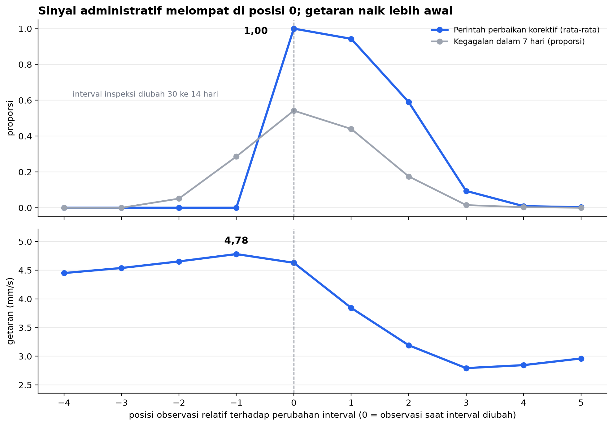

# Machine Failure Early-Warning — Feasibility Assessment

An assessment of whether a model can reliably flag machines at risk of failure within the
next seven days, based on 10,414 observations from 120 industrial machines.

---

## Recommendation

**The model is not ready for deployment in its current form.**

The headline score (PR-AUC 0.697) rests on two columns that are only populated *after* the
maintenance team has already identified a problem. With those columns removed, the
sensor-only model reaches PR-AUC 0.220 and does not meaningfully outperform a one-line
rule.

This does not mean the data is useless. Vibration readings rise five to ten days before
the maintenance team raises a corrective work order. The physical signal is real; what is
missing is a way to turn it into an alert precise enough for the field team to trust.

**What would change this recommendation:** confirmation from the data owner that
`corrective_orders_14d` and `inspection_interval_days` are genuinely populated before the
observation is recorded. If so, the 0.697 score is valid and the model is worth developing
further. Until that confirmation exists, the figure should not be used as a basis for
decisions.

---

## Data

| Property | Value |
|---|---|
| Observations | 10,414 |
| Machines | 120 |
| Period | 1 Jan 2024 – 28 Feb 2025 |
| Observation interval | 4.9 days on average |
| Failure base rate | 4.9% (508 rows) |

A 4.9% base rate rules out accuracy as a metric: a model that always answers "healthy" is
already 95.1% correct while providing no information. Evaluation uses **PR-AUC**
(precision-recall), with a reference point of 0.05 — the score a random guess achieves.

---

## Approach

1. **Check data quality first** — sentinel values, missing values, duplicates.
2. **Interrogate the lineage of every column before modelling.** Is each column genuinely
   available at the moment the observation is recorded, or is some of it only populated
   once the problem is already known?
3. **Split by time, not at random.** Machines are observed every five days while the label
   looks seven days ahead, so the label windows of adjacent rows overlap. A random split
   would score the model on information it has already seen. Train on data up to
   25 Oct 2024 (7,290 rows); test on everything after (3,124 rows).
4. **Establish a trivial baseline first**, so model scores have something to be measured
   against.
5. **Translate results into operational units** — alerts per week, not metrics alone.

The model is a `HistGradientBoostingClassifier`: it handles missing values natively,
requires no scaling, and suits mid-sized tabular data. Hyperparameters are deliberately
left untuned, because tuning is not where the problem lies.

---

## Key findings

### 1. A hidden sentinel value in the vibration column

`vibration_mm_s` contains 10 rows valued `-999`, a "no data" code stored as a number.
Vibration cannot be negative. Left in place, these rows shift the column mean from 3.73 to
2.78 mm/s and inflate the standard deviation to 31.2.

### 2. Two columns record a human decision, not a machine symptom



The data is realigned on event time: position 0 is the observation at which
`inspection_interval_days` is shortened from 30 to 14 days. This realignment is necessary
because the 120 machines undergo that change on different dates, which hides the pattern
under ordinary calendar time.

The upper panel shows `corrective_orders_14d` jumping from **exactly 0.000** to **exactly
1.000** at the same observation as the interval change. A step that clean is not produced
by a physical process. It indicates a single human decision: someone inspects the machine,
judges that something is wrong, and raises a corrective work order **and** shortens the
inspection interval in the same action.

Supporting evidence from the raw data:

- At `inspection_interval_days` = 14, the failure rate is **21%**; at 30 days, **1%**
- At `corrective_orders_14d` = 1, the failure rate is **45%**; at 0, **1%**

The lower panel carries the good news. Vibration has already climbed from 4.45 to
4.78 mm/s across the two observations before the event, while `corrective_orders_14d` is
still zero.

### 3. One binary column beats every sensor combined

Time-based split; random-guess reference = 0.050:

| Feature set | PR-AUC | ROC-AUC |
|---|---|---|
| All columns | 0.697 | 0.950 |
| `corrective_orders_14d` alone | 0.366 | 0.867 |
| Sensors + `unplanned_stops_14d` | 0.234 | 0.849 |
| Sensors only | 0.220 | 0.825 |

Sensors measure the physical condition of the machine, and a physical failure should be
preceded by a physical change. When a single 0/1 column is more predictive than every
physical measurement combined, that column is almost certainly not a symptom.

One point worth stating plainly: a **random** split with all columns gives PR-AUC 0.636,
*lower* than the 0.697 from the time-based split. So on this dataset, random splitting does
not inflate the score the way it usually would. The leakage lies in the **column contents**,
not in how the data is split. The time-based split is still the correct choice, because the
panel structure of the data demands it — not because it happens to lower the number.

### 4. The sensor model matches a one-line rule

Sensor-only model; 18-week test window, 157 failures:

| Recall | Precision | Alerts/week | Failures caught/week |
|---|---|---|---|
| 50% | 20% | 22 | 4.4 |
| 60% | 16% | 32 | 5.2 |
| 70% | 14% | 42 | 6.1 |
| 80% | 11% | 64 | 7.0 |
| 90% | 10% | 80 | 7.8 |

The one-line rule — *alert if the machine had an unplanned stop in the last 14 days* — on
the same test data: recall **90%**, precision **9%**, **86 alerts per week**. Compare that
with the final row of the table. The difference is six alerts a week.

In operational terms: at 10% precision, nine out of every ten machines a technician visits
are fine. A field team that experiences this for two weeks will stop responding to alerts,
at which point 90% recall on paper means nothing.

The most defensible operating point is 50% recall at 20% precision and roughly 22 alerts
per week, accepting that half of all failures still slip through. Choosing correctly
requires a cost ratio from the process owner — how many times more expensive is one missed
failure than one wasted inspection. That ratio is not available, so the full table is
presented for the owner to choose from.

---

## Suggested next steps

Assuming the administrative columns remain excluded:

- **Trend features rather than raw values.** The rise in vibration relative to a machine's
  own recent baseline is more informative than the absolute reading, because each machine
  has a different normal level.
- **Per-machine normalisation.** 4.5 mm/s may be routine on one machine and alarming on
  another.
- **Rolling time-based cross-validation** instead of a single split, to expose how stable
  the score is across periods.
- **A split that also separates machines**, to test whether the model still works on
  machines it has never seen.

---

## Repository contents

```
.
├── README.md              this summary
├── ASSUMPTIONS.md         assumptions and questions for the data owner
├── PANDUAN.md             step-by-step setup walkthrough (Indonesian)
├── requirements.txt       pinned library versions
├── data/
│   └── machine_observations.csv
├── notebooks/
│   └── analysis.ipynb     the full analysis, runs top to bottom
└── figures/
    └── event_time.png     produced by the notebook
```

---

## How to run

```bash
python -m venv venv
source venv/bin/activate          # Windows: venv\Scripts\activate
pip install -r requirements.txt
jupyter lab notebooks/analysis.ipynb
```

In JupyterLab, choose **Kernel → Restart Kernel and Run All Cells**. The notebook runs top
to bottom with no manual steps and reproduces every figure in this README. Randomness is
fixed with `RANDOM_STATE = 42`.
